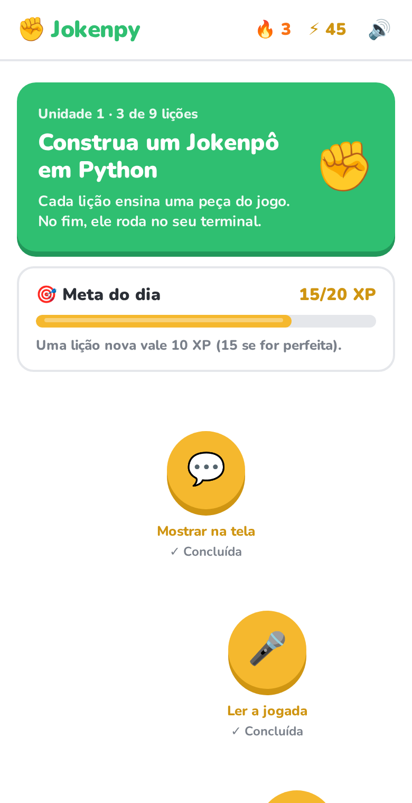

# Jokenpy: aprenda Python construindo um Jokenpô

Curso interativo de Python no estilo de app de idiomas. Uma trilha de 8 lições ensina, peça por peça,
a construir um jogo de pedra, papel e tesoura. No fim, você escreve o jogo inteiro e ele roda no terminal.

Feito com **FastAPI** no back-end e **HTML + JavaScript puro** no front-end, sem build.

<p align="center">
  
  
  
</p>

## Destaques técnicos

- **Código do aluno roda de verdade:** cada exercício executa Python num processo separado, com entradas simuladas
  para o `input()` e testes automáticos (`assert` e vários casos por exercício).
- **Hospedagem isolada:** em produção, o servidor roda num container Docker sem acesso à internet, somente leitura,
  sem privilégios e com limites de CPU, memória e processos.
- **Feito para aprender:** erros do Python explicados em português, revisão que prioriza o que você mais errou,
  progresso salvo a cada passo e barra de teclas de código no celular.
- **Sem build no front-end:** HTML, CSS e JavaScript puros, com realce de sintaxe e editor próprios.
- **Testado de ponta a ponta:** testes com Playwright percorrem o curso inteiro no desktop e no celular.

## Como funciona cada lição

1. **Ensino:** cartões curtos explicam o conceito com um exemplo que você pode editar e rodar. Dá para voltar, avançar ou **pular a explicação**.
2. **Exercícios:** múltipla escolha, completar lacunas, montar a linha com peças e escrever código de verdade.
   O código roda no servidor e passa por testes automáticos.
3. **Resultado:** XP, precisão, tempo, meta do dia e sequência de dias.

Durante os exercícios:

- **📖 Teoria** reabre toda a explicação da lição a qualquer momento.
- **💡 Dica** dá uma pista da IA, sem entregar a resposta.
- **Pular ⏭** deixa o exercício para o fim da lição, sem perder vida.
- **↻ Tentar de novo**: depois de errar, refaça o mesmo exercício na hora.
- No código: **▶ Executar**, **✨ Completar** (`Ctrl+Espaço`), **👀 Ver resposta** e **🧠 Como melhorar?**.
  A saída é conferida sem ligar para maiúsculas, acentos ou espaços extras.

Lições concluídas podem ser feitas de novo quantas vezes quiser.

Para fixar o conteúdo:

- **🔎 O que isso quer dizer:** todo erro do Python vem explicado em português, ao lado da mensagem original.
- **🧠 Revisão rápida:** 6 perguntas das lições já feitas, começando pelas que você mais errou.
- **🚀 Desafios bônus:** depois do projeto final, emojis, lagarto e Spock e melhor de 3.
- **No celular:** uma barra com Tab, recuo e símbolos de código aparece embaixo do editor.

## Como rodar

Precisa de Python 3.10 ou mais novo.

```bash
cd jokenpo
pip install -r requirements.txt
python -m uvicorn server:app --port 8080
```

Depois abra http://localhost:8080

### Dicas com IA (opcional)

Copie `.env.example` para `.env` e coloque uma chave do [Google AI Studio](https://aistudio.google.com/apikey):

```
GEMINI_API_KEY=sua-chave-aqui
```

A chave fica só no servidor e nunca vai para o navegador. Sem chave, o curso funciona normalmente:
os botões de IA somem e o 💡 abre a teoria da lição.

## Progresso

Tudo é salvo a cada passo: lições concluídas, XP, meta do dia, sequência, a lição em andamento
(cartão do ensino, exercício, vidas e erros) e o código que você está escrevendo.
Pode fechar a aba no meio: ao voltar, aparece **Continuar** na tela inicial.
O progresso fica no navegador e numa cópia em `progresso.json`.

## Arquivos

| Arquivo | O que é |
|---|---|
| `index.html` | A tela (HTML e estilos) |
| `app.js` | A lógica da tela: trilha, ensino, exercícios, progresso e IA |
| `licoes.js` | O conteúdo: cartões de ensino e exercícios de cada lição |
| `server.py` | API FastAPI: roda o código (`/executar`), salva o progresso (`/progresso`) e fala com a IA (`/ia`) |
| `_executor.py` | Roda o código do aluno com a entrada do teste e devolve erros legíveis |
| `jokenpo.py` | A resposta de referência do projeto final |
| `Dockerfile` | Imagem para hospedar o curso (modo público) |
| `testes/` | Testes de ponta a ponta com Playwright: percorrem o curso e os caminhos de erro |

Quando você passa no projeto final, o seu código é salvo em `meu_jokenpo.py`. Para jogar: `python meu_jokenpo.py`.

## Segurança

O servidor executa o código Python digitado na tela. Rodando com `uvicorn` como acima, ele é para
**uso só na sua máquina** (`127.0.0.1`) e recusa chamadas de outros sites. Não exponha esse modo na internet.

Para hospedar, use a imagem Docker numa rede sem saída para a internet, com limites de recursos:

```bash
docker build -t jokenpy:local .
docker network create --internal jokenpy-net
docker run -d --name jokenpy --network jokenpy-net --restart unless-stopped \
  --read-only --tmpfs /tmp:size=32m --memory 256m --pids-limit 64 --cpus 0.5 \
  --cap-drop ALL --security-opt no-new-privileges jokenpy:local
```

A imagem liga `JOKENPY_PUBLICO=1`: o progresso fica só no navegador de cada pessoa (nada de
`progresso.json` compartilhado) e, no fim, o projeto final é baixado em vez de salvo no servidor.
Para dar acesso, ponha um proxy reverso na mesma rede (ex.: um túnel `cloudflared`).
