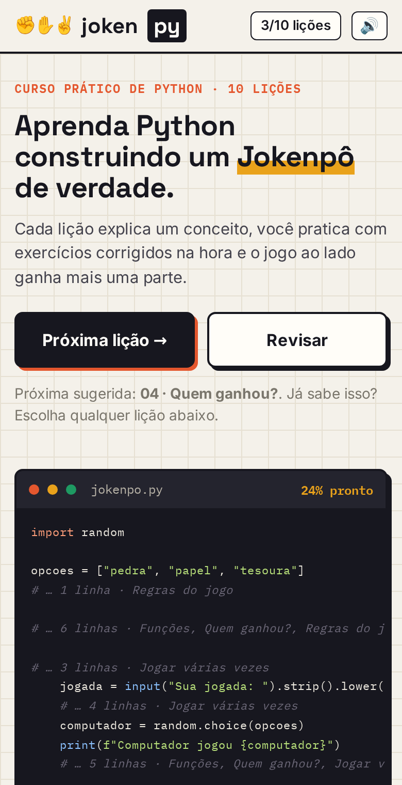
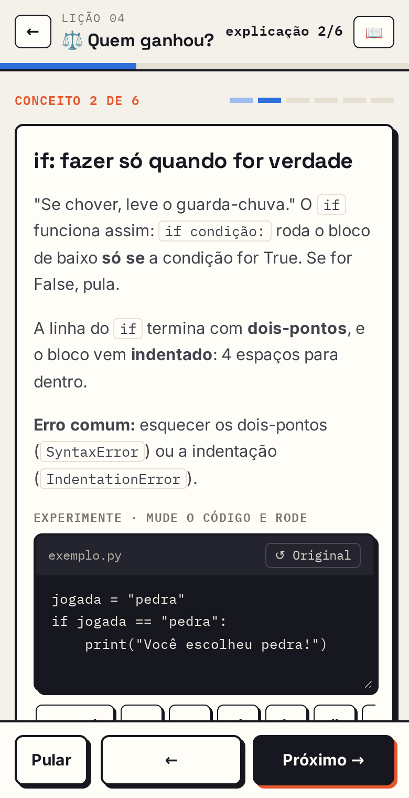
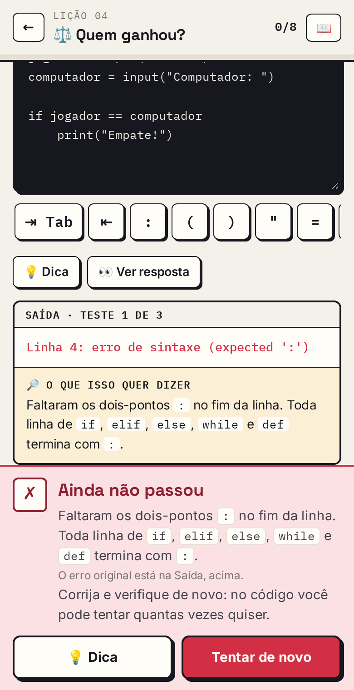

# Jokenpy: aprenda Python construindo um Jokenpô

Curso interativo de Python em que você aprende construindo um jogo de pedra, papel e tesoura.
São 10 lições, com 76 exercícios: cada uma explica um conceito, você pratica com correção na hora
e uma parte nova do `jokenpo.py` aparece na tela inicial. No fim, o jogo inteiro roda no seu terminal.

Feito com **FastAPI** no back-end e **HTML + JavaScript puro** no front-end, sem build.

<p align="center">
  
  
  
</p>

## Destaques técnicos

- **Código do aluno roda de verdade:** cada exercício executa Python num processo separado, com entradas simuladas
  para o `input()` e testes automáticos (`assert` e vários casos por exercício, para não dar para "decorar" a saída).
- **Hospedagem isolada:** em produção, o servidor roda num container Docker sem acesso à internet, somente leitura,
  sem privilégios e com limites de CPU, memória e processos.
- **Feito para aprender:** dicas progressivas em todos os exercícios, erros do Python explicados em português,
  revisão que prioriza o que você mais errou e barra de teclas de código no celular.
- **Sem build no front-end:** HTML, CSS e JavaScript puros, com realce de sintaxe e editor próprios.
- **Testado de ponta a ponta:** testes com Playwright percorrem o curso inteiro no desktop e no celular,
  e um validador roda a resposta de cada exercício contra os testes dele.

## As lições

Todas ficam liberadas desde o início: siga a ordem sugerida ou pule para o que quiser.

1. **Mostrar na tela:** `print`, strings, variáveis e f-string
2. **Ler a jogada:** `input()`, `strip()`, `lower()` e `int()`
3. **O computador joga:** listas, índices, `in` e `random.choice`
4. **Quem ganhou?:** `if`, `elif`, `else`, `==`, `and` e `or`
5. **Regras do jogo:** dicionários
6. **Funções:** `def`, parâmetros e `return`
7. **Jogar várias vezes:** `while`, `break`, `continue` e `+=`
8. **Histórico das jogadas:** `for`, `append`, `len` e `range`
9. **Projeto final:** o jogo completo
10. **Desafios bônus:** emojis, lagarto e Spock e melhor de 3

## Como funciona cada lição

1. **Explicação:** páginas curtas, uma ideia por vez, com exemplo que você edita e roda e o **erro comum** de cada assunto.
   Dá para voltar, avançar ou pular direto para os exercícios.
2. **Exercícios:** múltipla escolha, completar lacunas, montar a linha com peças e escrever código de verdade.
   Errou? Você vê a resposta e o porquê, e o exercício volta no fim da lição. Não há vidas nem pontos a perder.
3. **Resultado:** acertos de primeira, tempo, dicas usadas e um resumo **Para guardar** com o essencial da lição.

Durante os exercícios:

- **💡 Dica** revela uma pista por vez, da mais geral à mais específica, sem entregar a resposta.
- **📖 Resumo** abre o resumo e todas as explicações da lição.
- **Pular** deixa o exercício para o fim da lição.
- No código: **▶ Executar**, **👀 Ver resposta** e o erro do Python explicado em português.
  A saída é conferida sem ligar para maiúsculas, acentos ou espaços extras.
- Com uma chave do Gemini (opcional), aparecem também ✨ Completar, 🧠 Como melhorar? e perguntas à IA.

Para fixar o conteúdo, a **🧠 Revisão rápida** traz 6 perguntas das lições já feitas, começando pelas que você mais errou.
No celular, uma barra com Tab, recuo e símbolos de código aparece embaixo do editor.

## Como rodar

Precisa de Python 3.10 ou mais novo.

```bash
cd jokenpo
pip install -r requirements.txt
python -m uvicorn server:app --port 8080
```

Depois abra http://localhost:8080

### Dicas com IA (opcional)

Copie `.env.example` para `.env` e coloque uma chave do [Google AI Studio](https://aistudio.google.com/apikey):

```
GEMINI_API_KEY=sua-chave-aqui
```

A chave fica só no servidor e nunca vai para o navegador. Sem chave, o curso funciona normalmente:
os botões de IA somem e as dicas escritas continuam funcionando.

## Progresso

Tudo é salvo a cada passo: lições concluídas, dias seguidos de estudo, a lição em andamento
(explicação ou exercício em que parou e os erros) e o código que você está escrevendo.
Pode fechar a aba no meio: ao voltar, aparece **Continuar** na tela inicial.
O progresso fica no navegador e numa cópia em `progresso.json`.

## Arquivos

| Arquivo | O que é |
|---|---|
| `index.html` | A tela (HTML e estilos) |
| `app.js` | A lógica da tela: sumário, explicações, exercícios, dicas, progresso e IA |
| `licoes.js` | O conteúdo: explicações, exercícios, dicas e resumo de cada lição |
| `server.py` | API FastAPI: roda o código (`/executar`), salva o progresso (`/progresso`) e fala com a IA (`/ia`) |
| `_executor.py` | Roda o código do aluno com a entrada do teste e devolve erros legíveis |
| `jokenpo.py` | A resposta de referência do projeto final |
| `Dockerfile` | Imagem para hospedar o curso (modo público) |
| `testes/` | Testes de ponta a ponta com Playwright: percorrem o curso e os caminhos de erro |

Quando você passa no projeto final, o seu código é salvo em `meu_jokenpo.py`. Para jogar: `python meu_jokenpo.py`.

## Segurança

O servidor executa o código Python digitado na tela. Rodando com `uvicorn` como acima, ele é para
**uso só na sua máquina** (`127.0.0.1`) e recusa chamadas de outros sites. Não exponha esse modo na internet.

Para hospedar, use a imagem Docker numa rede sem saída para a internet, com limites de recursos:

```bash
docker build -t jokenpy:local .
docker network create --internal jokenpy-net
docker run -d --name jokenpy --network jokenpy-net --restart unless-stopped \
  --read-only --tmpfs /tmp:size=32m --memory 256m --pids-limit 64 --cpus 0.5 \
  --cap-drop ALL --security-opt no-new-privileges jokenpy:local
```

A imagem liga `JOKENPY_PUBLICO=1`: o progresso fica só no navegador de cada pessoa (nada de
`progresso.json` compartilhado) e, no fim, o projeto final é baixado em vez de salvo no servidor.
Para dar acesso, ponha um proxy reverso na mesma rede (ex.: um túnel `cloudflared`).
